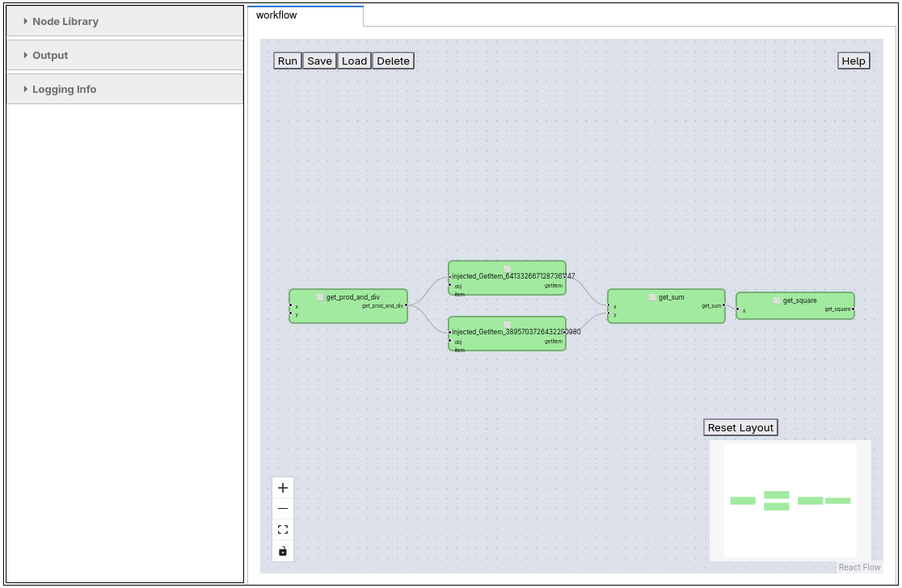

# Visual Programming
[](https://mybinder.org/v2/gh/pythonworkflow/visual-programming-with-pyironflow/HEAD)



Load the [Python Workflow Definition](https://pythonworkflow.github.io) with the visual programming environment [pyironflow](https://github.com/pyiron/pyironflow):

```python
from pyironflow import PyironFlow
from python_workflow_definition.pyiron_workflow import load_workflow_json

PyironFlow([load_workflow_json(file_name="workflow.json")]).gui
```

The main motivation for supporting visual programming environments with the Python Workflow Definition is that they simplify the discussion of workflows. 
When we introduce a new workflow, we commonly illustrate it as data flow diagram. A visual programming environment allows you to:

- Browse through the workflow and zoom in on individual parts to analyze which data is transferred between the different steps.
- Furthermore, a visual programming environment enables debugging the data flow, by allowing the user to execute individual steps, or the workflow up to a specific step and print the data at a given step.
- Finally, for technically less inclined users a visual programming environment provides the ability to use workflow developed by experts. This accelerates the knowledge transfer between different user groups.

In conclusion the visual programming approach provides an alternative perspective to working with the Python Workflow Definition. 
